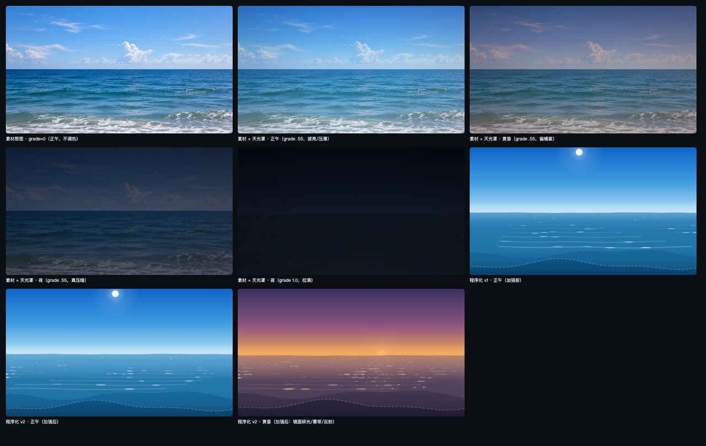
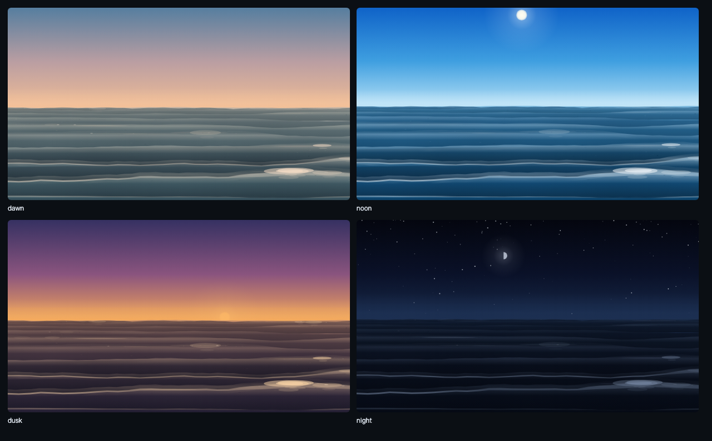
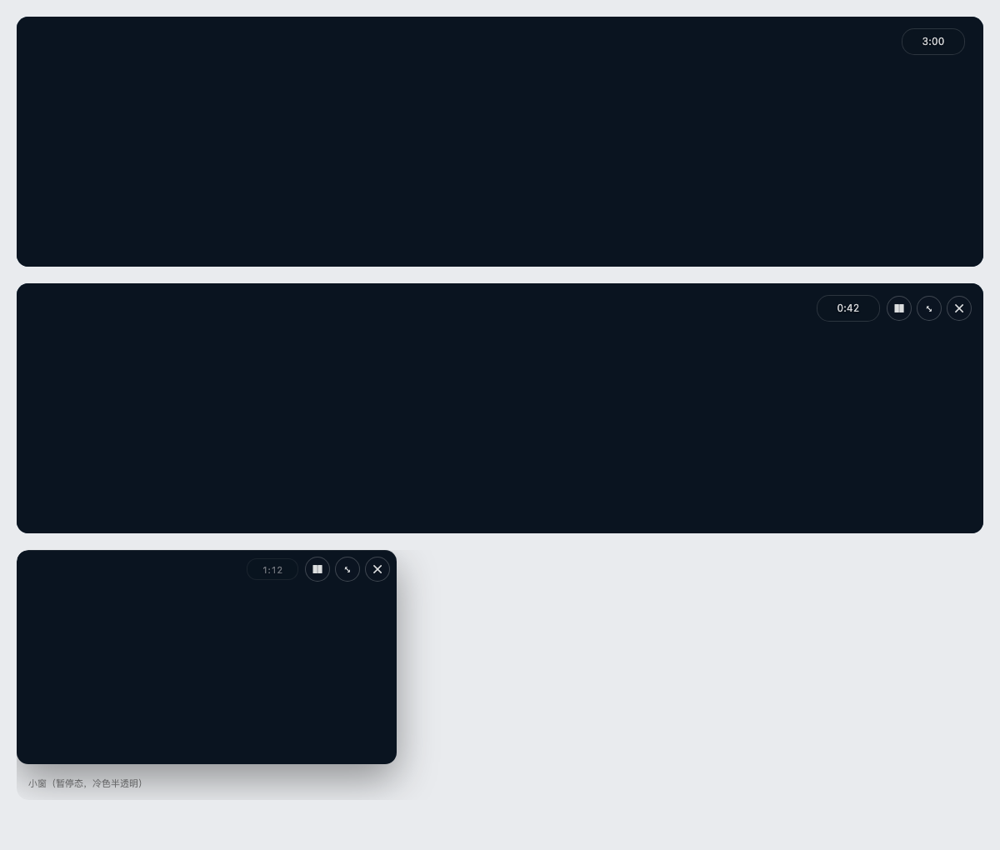

# Intertidal · dsh-intertidal

[](https://www.npmjs.com/package/dsh-intertidal)
[](LICENSE)
[](package.json)

English | [中文](README.md)

Every N minutes the screen is handed to the sea **as it is right now**, for three minutes, then it is handed back. The light and the hour come from the **local solar position**; your own photos or videos can replace the procedural water. No data is fetched, nothing is collected, nothing is written into your conversation.



## What it does

- **On a schedule** — 3 minutes every 120 minutes by default. It fades out on its own: no prompt, no residue, your draft and scroll position untouched.
- **True to this moment** — the phase comes from **solar altitude**, not clock time (Shanghai may be at dusk while Reykjavik is still in the afternoon); the moon is drawn from a 29.53-day synodic approximation; stars at night; polar day/night handled separately.
- **Two kinds of sea**:
  - procedural — five palettes plus wave fronts advancing toward the viewer, no network and no assets (the fallback);
  - media — a random image/video from a folder you choose, or a web/image link that is fetched once and cached, then graded to match the current light.
- **Countdown in the top-right** — always-visible `m:ss`, frozen while paused.
- **Forms** — full screen, or a draggable corner window that snaps to any corner; both share the remaining time of the same appearance.
- **Stays out of the way** — quiet hours, defers while you type (up to 10 minutes), “skip today”, a 20-minute first-appearance delay.
- **Accessibility** — follows the system “reduce motion” setting (single static frame), with a manual override.
- **Optional sound** — synthesised surf (band-passed white noise + a 0.08 Hz tidal LFO). Off by default, one click to unlock.



## Install

**Plugin market** — open **Plugins → Plugin Market** in DSH and search for `dsh-intertidal`.

**CLI**:

```sh
dsh plugin --profile <your-profile> add dsh-intertidal
```

**From source (local link)**:

```sh
pnpm add link:/path/to/dsh-intertidal   # run inside the profile directory
```

Refresh the page after installing; the host half needs one restart the first time it is loaded.

## Settings

Settings → Intertidal:

| Group | Items | Defaults |
| --- | --- | --- |
| Rhythm | automatic / interval / duration / first delay | on / 120 min / 3 min / 20 min |
| | quiet hours / defer while typing / manual viewing pushes the next one | 23:00–07:00 / on / on |
| Form | full screen or corner window / remember last form / corner caption | full / on / on |
| Scenery | source (procedural / local folder / web links) / time-of-day grade / slow push / new one each time | procedural / 0.55 / 0.5 / on |
| Place | 74 built-in cities / custom coordinates + timezone | guessed from system timezone |
| Sound | surf on/off + volume | off / 0.35 |
| Accessibility | reduced motion | follow system |

Manual entry: the **Look at the sea** button in settings, or bind a key to the `intertidal.open` command in **Settings → Shortcuts** (it ships with no default binding so it cannot collide with another plugin).



## API

The host half serves four routes under `/intertidal`; every request passes an admission fence that only accepts same-origin requests from the local page:

| Method | Path | Purpose |
| --- | --- | --- |
| GET | `/intertidal/state` | settings + rhythm + current sky parameters |
| POST | `/intertidal/settings` | partial update (ranges are clamped on the host) |
| POST | `/intertidal/rhythm` | `shown` / `hidden` / `skip-today` / `manual-open` |
| GET | `/intertidal/now` | sun / moon / tide / phase / sunrise-sunset |

Media mode adds `/intertidal/media`, `/intertidal/media/file`, `/intertidal/media/resolve`, `/intertidal/media/scan`.

State: `~/.dsh/intertidal/state.json` (atomic write, `0600`). Media cache: `~/.dsh/intertidal/cache/` (200 MB cap, oldest evicted first).

## Compatibility

- DSH `>=0.2.1-rc.5 <0.3.0` (`engines.dsh`), Node `>=20`.
- Uses two slots: `shell.overlay` (the overlay) and `settings.section` (the settings page). A failed registration only logs a warning; it never affects DSH startup.
- Registers no sidebar row and does not touch the content area.

## Privacy

- No telemetry, no usage upload. The only network requests come from links you paste into media mode.
- Does not read the screen, the clipboard or your documents; only appearance timestamps and “skip today” dates are stored.
- Media mode serves files from the folder you chose by basename + extension whitelist only; links must be public http/https (loopback and private ranges are refused).

## Development

```sh
npm run build      # esbuild → dist/client.js (ModuleLoader wrapper)
npm test           # node --test: astronomy / settings / store / rhythm / i18n / host routes / client boot
npm run verify     # build + full test suite
```

Design notes and the implementation log live in `docs/IMPLEMENTATION.md` and `docs/STATUS.md`; the internal contracts are in `docs/CONTRACTS.md`.

## License

[MIT](LICENSE)