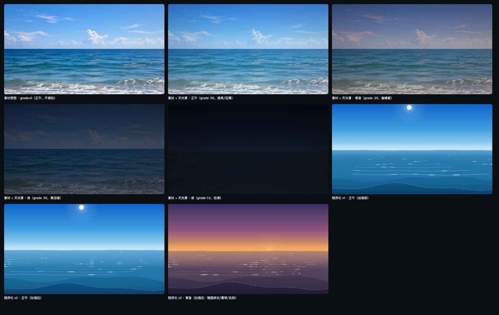
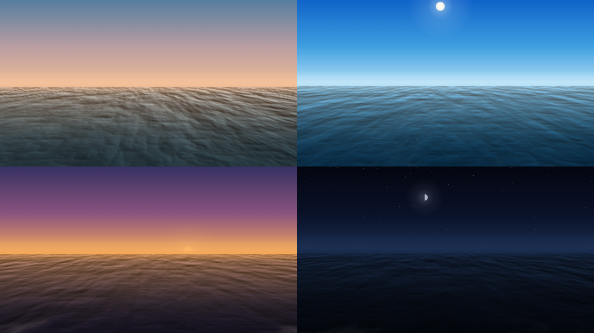
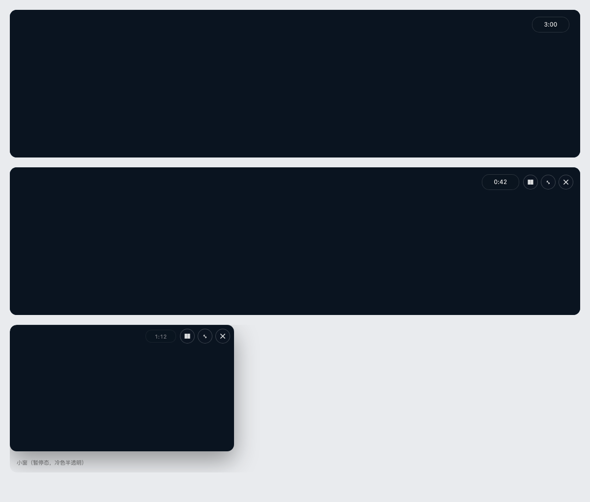

# 潮间 · dsh-intertidal

[](https://www.npmjs.com/package/dsh-intertidal)
[](LICENSE)
[](package.json)

[English](README.en.md) | 中文

按设定的间隔把 DSH 的屏幕交给一片**此刻**的海，三分钟后再还给工作。天光和时辰由**本地太阳位置**算出，也可以换成你自己的照片或视频。不联网取数、不采集数据、不写会话记录。



## 功能

- **定时浮现**：默认每 120 分钟浮现 3 分钟，到点自己淡出——不弹确认、不留残留、不动你的输入框与滚动位置。
- **忠于此刻**：时段按**太阳高度角**判定而不是钟点（同一刻上海是黄昏、雷克雅未克可能还是下午）；月相按 29.53 天朔望周期绘制；夜里出星；高纬极昼极夜走单独分支。
- **两种海面**：
  - 程序化海：五档色阶 + **斑块场**（按透视随机分布的水面碎块，近处大、远处细碎，带碎光与近岸白浪），不联网、不需要任何素材（兜底）；
  - 素材模式：本地目录随机取一张图片/视频，或给网页/图片链接自动抓取缓存，再按此刻天光着色。
- **右上角倒计时**：`m:ss` 常驻，显示还有多久退干净；暂停时数字冻结。
- **形态**：整屏 / 右下角小窗（可拖拽、吸附四角），两者共享同一次浮现的剩余时长。
- **不打扰**：夜间静默、输入中推迟（最多等 10 分钟）、「今天跳过」、首次投放延迟 20 分钟。
- **无障碍**：跟随系统「减少动态」（静态一帧），设置页可强制开关。
- **可选声音**：WebAudio 合成的海浪（带通白噪声 + 0.08 Hz 潮汐 LFO），默认关，点一次解锁。



## 安装

**插件市场**：在 DSH 的 **插件 → 插件市场**里搜索 `dsh-intertidal` 安装。

**命令行**：

```sh
dsh plugin --profile <你的 profile> add dsh-intertidal
```

**从源码（本机 link）**：

```sh
pnpm add link:/path/to/dsh-intertidal   # 在 profile 目录里执行
```

装完刷新页面即可（宿主半片首次加载需要一次重启）。

## 配置

设置 → 潮间：

| 分组 | 项 | 默认 |
| --- | --- | --- |
| 节奏 | 自动浮现 / 间隔 / 每次时长 / 首次投放延迟 | 开 / 120 分钟 / 3 分钟 / 20 分钟 |
| | 静默时段 / 输入中推迟 / 手动看过后顺延 | 23:00–07:00 / 开 / 开 |
| 形态 | 浮现形式 / 记住上次形态 / 角落小字 | 整屏 / 开 / 开 |
| 画面素材 | 来源（程序化海 / 本地目录 / 网页链接）/ 天光着色 / 缓慢推拉 / 每次换一张 | 程序化海 / 0.55 / 0.5 / 开 |
| 地点 | 城市（74 个内置）/ 自定义经纬度 + 时区 | 按系统时区猜 |
| 声音 | 海浪声 + 音量 | 关 / 0.35 |
| 无障碍 | 减少动态 | 跟随系统 |

手动入口：设置页的「看一眼海」；也可以到 **设置 → 快捷键** 给命令 `intertidal.open`（「涨一次潮」）绑一个键——它不自带默认键位，避免与其他插件抢。



## 接口

宿主半片在 `/intertidal` 下提供四个接口，每个请求都先过准入围栏（只接受本机页面发起的同源请求）：

| 方法 | 路径 | 作用 |
| --- | --- | --- |
| GET | `/intertidal/state` | 设置 + 节奏 + 当前天文参数 |
| POST | `/intertidal/settings` | 局部更新设置（宿主侧做范围钳制） |
| POST | `/intertidal/rhythm` | `shown` / `hidden` / `skip-today` / `manual-open` |
| GET | `/intertidal/now` | 太阳/月亮/潮汐/时段/日出日落 |

素材模式额外提供 `/intertidal/media`、`/intertidal/media/file`、`/intertidal/media/resolve`、`/intertidal/media/scan`。

状态文件：`~/.dsh/intertidal/state.json`（原子写，`0600`）。素材缓存：`~/.dsh/intertidal/cache/`（上限 200 MB，按最旧淘汰）。

## 兼容性

- 需要 DSH `>=0.2.1-rc.5 <0.3.0`（`engines.dsh`），Node `>=20`。
- 依赖四个槽位：`shell.overlay`（覆盖层）、`settings.section`（设置页）；任一注册失败只打印告警，不影响 DSH 启动。
- 不注册侧栏入口、不改内容区布局。

## 隐私

- 不采集、不上传任何使用数据；唯一的网络请求来自你自己在素材模式里填的链接。
- 不读屏幕、不读剪贴板、不读文档；只记录浮现时间戳与「今天跳过」的日期。
- 素材模式读的是你指定的目录，文件名只按 basename + 扩展名白名单服务，链接只接受公网 http/https（拒绝回环与私有网段）。

## 开发

```sh
npm run build      # esbuild → dist/client.js（ModuleLoader 外壳）
npm test           # node --test：天文 / 设置 / 存储 / 节奏 / 文案 / 宿主接口 / 客户端装载
npm run verify     # 构建 + 全量测试
```

设计文档与实施记录见 `docs/IMPLEMENTATION.md`、`docs/STATUS.md`；浏览器半片与宿主半片的接口契约见 `docs/CONTRACTS.md`。

## 许可

[MIT](LICENSE)